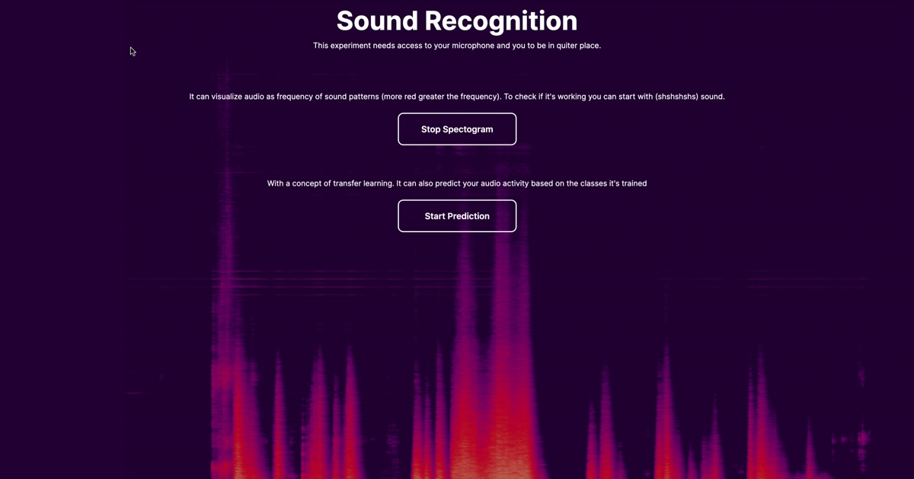

# Audiochi

**Real-time sound recognition and visualization, running entirely in the browser.**

[Live demo →](https://audiochi.vercel.app) · [3D view →](https://audiochi.vercel.app/viewIn3D)



Audiochi listens through your microphone and does three things at once:

- **Scrolling spectrogram.** A 2D frequency-over-time view drawn on canvas from a 4096-point FFT.
- **3D sound landscape.** A 1000 × 128 vertex terrain built with three.js. A custom GLSL shader raises and colors each vertex by loudness.
- **Sound classification.** A 1.3M-parameter CNN that I trained on ESC-50 recognizes 50 everyday sounds live. It runs as a 1.3 MB int8 ONNX model in the browser.

No audio leaves the device. All processing runs client-side with the Web Audio API, WebGL and onnxruntime-web.

## How it works

```
Microphone ─► getUserMedia ─► AudioContext ─► AnalyserNode (FFT) ─┬─► 2D canvas spectrogram
                                                                  └─► three.js terrain (GLSL)
Microphone ─► AudioWorklet PCM ─► 16 kHz resampler ─► log-mel (JS) ─► int8 ONNX CNN ─► calibrated probabilities
```

### Audio pipeline

`useMicAnalyser` (`src/hooks/useMicAnalyser.js`) owns the full lifecycle: microphone stream, `AudioContext` and `AnalyserNode`. Everything is held in refs and released on stop or unmount. A getUserMedia promise that resolves after the user already pressed Stop is detected and discarded, so the microphone indicator never gets stuck on. Permission errors are mapped to messages the user can act on.

The analyser runs an FFT over the time-domain signal. `getByteFrequencyData` returns `fftSize / 2` bins of loudness (0–255).

### 2D spectrogram

Each animation frame shifts the canvas 1px left with `drawImage` and paints one new column on the right edge. The new column comes from a single `ImageData` write. Loudness is mapped to color through a precomputed 256-entry lookup table, so building a frame needs no string allocation and no per-pixel `strokeStyle`.

### 3D terrain

`src/utility/spectrogram3d.js` builds an indexed `BufferGeometry` with log-like spacing on the frequency axis. Each frame, the displacement buffer scrolls one time step with `copyWithin`, the newest spectrum is written into the last row, and only `needsUpdate` is flagged, so nothing is reallocated. The vertex shader (`src/utility/vertexshader.js`) displaces vertices along their normals and colors them from a 256-entry magma-style table. The view owns its renderer and frees the WebGL context on unmount.

### Sound classification: my own model, end to end

The model is trained, evaluated and quantized by the pipeline in [`training/`](training/README.md):

| | ESC-50 5-fold accuracy | Size |
|---|---|---|
| Teacher: PANNs CNN14 (frozen) + linear probe | 91.8% | 80.8M params |
| Student CNN, baseline | 80.2% (5 s clips) | 1.3M params |
| **Shipped student: augmentation + distillation from the teacher** | **84.3% (5 s)** · **80.8% (live 2 s windows)** | **1.3 MB int8** |

- **Training-serving parity.** The log-mel front end is implemented twice: in PyTorch for training and in JavaScript for the browser (`src/ml/logmel.js`). Golden vectors test that both match within 0.01 dB.
- **Streaming resampler.** A windowed-sinc filter converts device audio (44.1/48 kHz) to 16 kHz chunk by chunk, without aliasing.
- **Quantization.** Static int8 (QDQ, per-channel). It is 3.9× smaller and 3.3× faster on CPU, with no accuracy loss on the held-out fold.
- **Calibration.** Expected calibration error is 0.027 out of fold, checked with cross-fitted temperature scaling.

The pipeline has a full ablation, a confusion matrix, failure analysis and a model card. See [training/README.md](training/README.md).

<details>
<summary>v1 (2024): Teachable Machine</summary>

The first version fine-tuned Google's speech-commands CNN in Teachable Machine on a few self-recorded classes. Replacing it with my own pipeline is what Phase 1 of the roadmap was about.

</details>

## Tech stack

**Web:** Next.js 16 · React 19 · Web Audio API + AudioWorklet · three.js + GLSL · onnxruntime-web · Tailwind CSS · Jest · Cypress · CircleCI → Vercel

**ML:** PyTorch · PANNs CNN14 · scikit-learn · ONNX + onnxruntime quantization · librosa · uv

## Run locally

```bash
npm install
npm run dev          # http://localhost:3000
npm test             # unit tests (Jest)
npm run build && npm start   # then, in another terminal:
npm run e2e          # Cypress, with a fake microphone in Chromium

cd training && make all   # retrain the model from scratch (~1.5 h on an M2 Pro)
```

Requires Node 20.9 or newer. Microphone access needs `localhost` or HTTPS.

## Roadmap

- [x] **Phase 0: foundations.** Leak-free audio lifecycle, error and loading states, shared mic hook, App Router only, social preview metadata, meaningful tests, dependency cleanup.
- [x] **Phase 1: own the model.** A PyTorch pipeline on ESC-50: log-mel front end with JS parity tests, a CNN14 teacher, an ablation over augmentation and distillation, int8 ONNX, calibration and a model card.
- [ ] **Phase 2: ML features.** Teach a new sound in the browser (embeddings + few-shot classifier), a 3D embedding explorer (UMAP), saliency overlays showing what the model listened to, and unknown-sound detection.
- [ ] **Phase 3: visual polish.** Mel-frequency axis with labels, perceptual colormap, orbit controls and lighting in 3D, and file upload so the demo works without a microphone.
