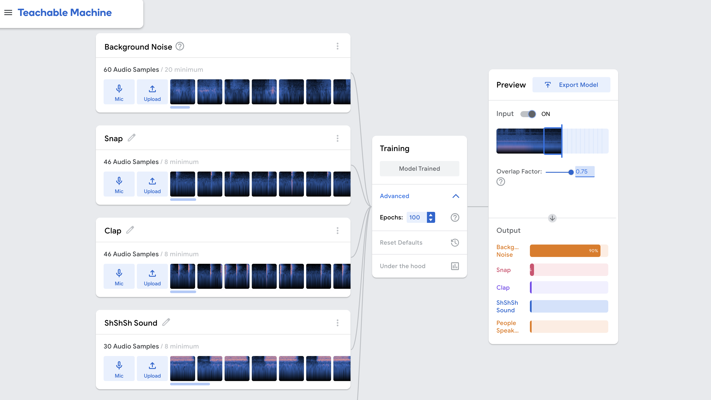
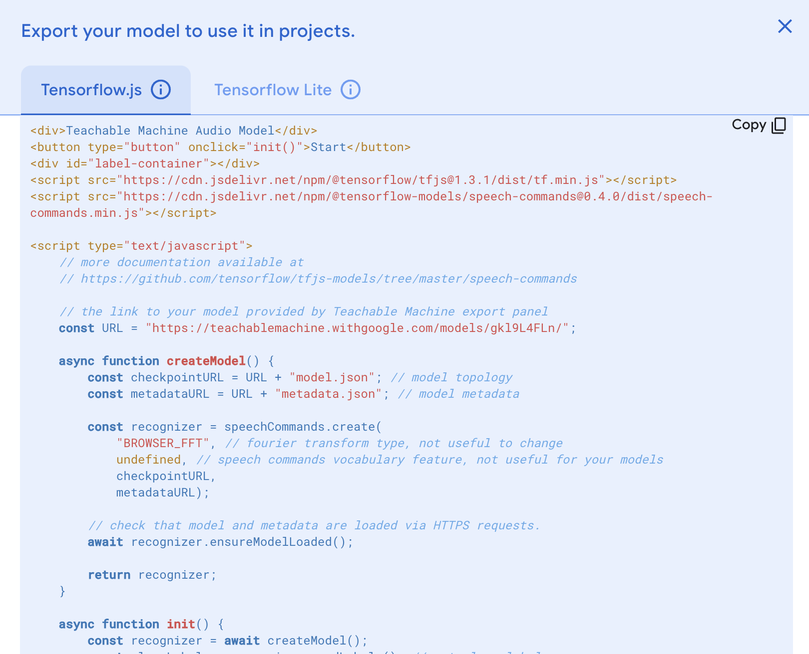

# Audiochi

**Real-time sound recognition and visualization, running entirely in the browser.**

[Live demo →](https://audiochi.vercel.app) · [3D view →](https://audiochi.vercel.app/viewIn3D)


Audiochi listens through your microphone and does three things at once:

- **Scrolling spectrogram.** A 2D frequency-over-time view drawn on canvas from a 4096-point FFT.
- **3D sound landscape.** A 1000 × 128 vertex terrain built with three.js. A custom GLSL shader raises and colors each vertex by loudness.
- **Sound classification.** A convolutional network recognizes background noise, claps, snaps, "shhh" and speech, with live confidence bars.

No audio leaves the device. All processing runs client-side with the Web Audio API, WebGL and TensorFlow.js.

## How it works

```
Microphone ─► getUserMedia ─► AudioContext ─► AnalyserNode (FFT) ─┬─► 2D canvas spectrogram
                                                                  └─► three.js terrain (GLSL)
Microphone ─► TF.js speech-commands (BROWSER_FFT) ─► CNN ─► class probabilities ─► confidence bars
```

### Audio pipeline

`useMicAnalyser` (`src/hooks/useMicAnalyser.js`) owns the full lifecycle: microphone stream, `AudioContext` and `AnalyserNode`. Everything is held in refs and released on stop or unmount. A getUserMedia promise that resolves after the user already pressed Stop is detected and discarded, so the microphone indicator never gets stuck on. Permission errors are mapped to messages the user can act on.

The analyser runs an FFT over the time-domain signal. `getByteFrequencyData` returns `fftSize / 2` bins of loudness (0–255).

### 2D spectrogram

Each animation frame shifts the canvas 1px left with `drawImage` and paints one new column on the right edge. The new column comes from a single `ImageData` write. Loudness is mapped to color through a precomputed 256-entry lookup table, so building a frame needs no string allocation and no per-pixel `strokeStyle`.

### 3D terrain

`src/utility/spectrogram3d.js` builds an indexed `BufferGeometry` with log-like spacing on the frequency axis. Each frame, the displacement buffer scrolls one time step with `copyWithin`, the newest spectrum is written into the last row, and only `needsUpdate` is flagged, so nothing is reallocated. The vertex shader (`src/utility/vertexshader.js`) displaces vertices along their normals and colors them from a 256-entry magma-style table. The view owns its renderer and frees the WebGL context on unmount.

### Sound classification

The classifier is a transfer-learned model: Google's speech-commands CNN backbone (input: 43 frames × 232 FFT bins), with a new classification head fine-tuned on my own recorded samples using [Teachable Machine](https://teachablemachine.withgoogle.com/). It runs in the browser through TF.js `speech-commands` with the `BROWSER_FFT` front end.

<details>
<summary>Training and export screenshots</summary>




</details>

## Tech stack

Next.js 16 (App Router) · React 19 · Web Audio API · three.js + GLSL · TensorFlow.js · Tailwind CSS · Jest + Testing Library · Cypress · CircleCI → Vercel

## Run locally

```bash
npm install
npm run dev          # http://localhost:3000
npm test             # unit tests (Jest)
npm run build && npm start   # then, in another terminal:
npm run e2e          # Cypress, with a fake microphone in Chromium
```

Requires Node 20.9 or newer. Microphone access needs `localhost` or HTTPS.

## Roadmap

- [x] **Phase 0: foundations.** Leak-free audio lifecycle, error and loading states, shared mic hook, App Router only, social preview metadata, meaningful tests, dependency cleanup.
- [ ] **Phase 1: own the model.** A PyTorch training pipeline on ESC-50 plus custom recordings: log-mel features, SpecAugment, a model ablation (small CNN → YAMNet → PANNs), int8 ONNX export, accuracy and latency benchmarks, and a model card.
- [ ] **Phase 2: ML features.** Teach a new sound in the browser (embeddings + few-shot classifier), a 3D embedding explorer (UMAP), saliency overlays showing what the model listened to, and unknown-sound detection.
- [ ] **Phase 3: visual polish.** Mel-frequency axis with labels, perceptual colormap, orbit controls and lighting in 3D, and file upload so the demo works without a microphone.
